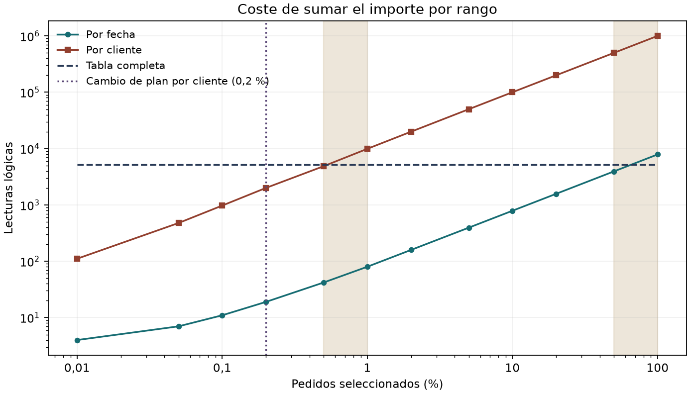

# Laboratorio 5 · Oracle DBA Workflow II

## Preguntas de comprobación

### 1. Compara el paso 6 de tu copia lab4-final con el de la copia lab3-final. ¿Qué demuestra la diferencia?

El paso 6 contó cero archivos externos en las dos copias. En el Lab 3 las rutas bajo dbs resolvían dentro del volumen. Tras la reubicación, el Lab 4 registra los archivos de negocio en el directorio de datos. Cambió la ruta registrada y ambas copias cubren los datos. [20261122T134358Z_00-backup-lab4.script.log](lab5/evidencia/script/20261122T134358Z_00-backup-lab4.script.log)

### 2. Calcula el factor de bloqueo (bfr) de CLIENTE y de PEDIDO con sus estadísticas. ¿Por qué PEDIDO cabe casi el triple de filas por bloque?

CLIENTE almacena 100 000 / 1 517 = 65,9 filas por bloque y PEDIDO 1 000 000 / 5 320 = 188,0. Una fila media ocupa 102 y 32 bytes, respectivamente. El recuento físico de bloques con filas de PEDIDO dio mínimo 2, media 191,57 y máximo 200. La longitud variable, el espacio reservado y los bloques parcialmente ocupados explican la dispersión. [20261122T134555Z_01-perfil-tiendasur.script.log](lab5/evidencia/script/20261122T134555Z_01-perfil-tiendasur.script.log)

### 3. ¿Por qué el banco de medida ejecuta cada sentencia dos veces y mide solo la segunda?

La primera ejecución calienta la caché y puede incluir análisis o limpieza diferida. Para el pedido 4711, la segunda devuelve una fila con 4 lecturas lógicas, tres del índice y una del bloque de tabla. La comparación usa el mismo estado de caché. [20261122T134556Z_02-anatomia-indice.script.log](lab5/evidencia/script/20261122T134556Z_02-anatomia-indice.script.log)

### 4. Con tu evidencia 02: altura, número de hojas y factor de ramificación (fan-out) real de IX_PED_CLIENTE. ¿Qué altura tendría con mil millones de filas?

IX_PED_CLIENTE tiene altura 3, 2 216 hojas y 6 bloques de rama. El fan-out medio es (2 216 + 6 − 1) / 6 ≈ 370. Con mil millones de filas, la proyección da 2 208 969 hojas y altura 4. [20261122T134556Z_02-anatomia-indice.script.log](lab5/evidencia/script/20261122T134556Z_02-anatomia-indice.script.log)

### 5. En el volcado de la hoja de PK_CLIENTE, localiza una entrada y descompón el ROWID que guarda en bloque y fila. ¿Por qué no aparece el número de archivo?

La primera entrada de PK_CLIENTE contiene la clave c1 02 (cliente 1) y los bytes 00 00 03 1b 00 00. Los cuatro primeros identifican el bloque 795 y los dos últimos la ranura 0. En este tablespace bigfile el archivo queda determinado por el tablespace. [20261122T134556Z_02-anatomia-indice.script.log](lab5/evidencia/script/20261122T134556Z_02-anatomia-indice.script.log)

### 6. Elige tres pruebas de la Parte D y explica, con las lecturas lógicas medidas, por qué un tipo de índice gana al otro.

Q13 pasó de 1 486 a 3 lecturas con un índice único sobre DNI. En Q7, el índice por cliente costó 15 lecturas, el compuesto cliente-fecha 7 y el cubriente 3 al devolver las cuatro filas desde sus hojas. Q1 pasó de 1 486 a 4 al indexar la expresión UPPER(email). [20261122T134557Z_03-tipos-indice.script.log](lab5/evidencia/script/20261122T134557Z_03-tipos-indice.script.log)

### 7. ¿Por qué IX_PED_FECHA tiene un clustering factor cercano al número de bloques e IX_PED_CLIENTE cercano al de filas? ¿Lo arreglaría un REBUILD?

Los pedidos se cargaron por fecha. IX_PED_FECHA visita los bloques casi en su orden físico (CF 5 220 para 5 320 bloques). Por cliente salta entre bloques (CF 999 041 para un millón de filas). REBUILD reordena las hojas, pero conserva los ROWID de las filas. [20261122T134615Z_04-agrupamiento-equilibrio.script.log](lab5/evidencia/script/20261122T134615Z_04-agrupamiento-equilibrio.script.log)

### 8. Según tu curva de la Parte E, ¿a partir de qué porcentaje deja de compensar cada índice? Compáralo con la fórmula de la Unidad 3.

El recorrido completo costó 5 232 lecturas. Por cliente, el cruce está entre 0,5 % (4 875) y 1 % (9 920), cerca de 1/188 = 0,53 %. Por fecha ocurre entre 50 % (3 938) y 100 % (7 875). El optimizador cambió a recorrido completo en 0,2 % para cliente. Su coste pondera las lecturas aleatorias y multibloque. [20261122T134615Z_04-agrupamiento-equilibrio.script.log](lab5/evidencia/script/20261122T134615Z_04-agrupamiento-equilibrio.script.log)

### 9. Explica por qué Q4b ('Gonz%') usa el índice y aun así lee más bloques que un recorrido completo.

Gonz% delimita un rango de claves, pero recuperar las columnas de 2 056 clientes dispersos requiere 2 024 lecturas. El recorrido completo de CLIENTE ronda las 1 486. Que el predicado permita un índice no garantiza un coste menor. [20261122T134627Z_05-sargabilidad.script.log](lab5/evidencia/script/20261122T134627Z_05-sargabilidad.script.log)

### 10. Con tu evidencia 06: bloques modificados por INSERT con 4, 9 y 5 índices. ¿Qué índices de la propuesta del compañero rechazaste y con qué dato?

Para 2 000 INSERT se modificaron 10,2 bloques por fila con 4 índices, 20,2 con 9 y 12,1 con los 5 finales. CANAL y FEC_CLI tuvieron cero usos observados. ESTADO solo tiene 4 valores y para pendientes basta un índice parcial del 2 %. El cubriente conserva el prefijo de la clave ajena. [20261122T134629Z_06-indices.script.log](lab5/evidencia/script/20261122T134629Z_06-indices.script.log)

### 11. Distingue, con tus gráficos de la Parte H, un índice con divisiones 50/50, uno con divisiones 90/10 y uno con patrón cola.

Con 200 000 inserciones, IX_AZAR tuvo 595 divisiones y ninguna 90/10, con 336 entradas por hoja. En IX_CRECIENTE las 398 divisiones fueron 90/10 y quedaron 501 entradas por hoja. La cola se reconoce por sus hojas vaciadas a la izquierda y la actividad concentrada a la derecha. [20261122T134641Z_07a-crecimiento.script.log](lab5/evidencia/script/20261122T134641Z_07a-crecimiento.script.log)

### 12. ¿Qué remedio elegirías para el patrón cola en producción, en horario de servicio, y por qué?

Elegiría COALESCE en horario de servicio. La siguiente extracción bajó de 226 a 2 lecturas y las hojas de 425 a 201. Conservó los 4 MB asignados. Si el objetivo fuera devolver espacio al tablespace, SHRINK redujo el segmento a 1,69 MB. [20261122T134641Z_07c-remedios.script.log](lab5/evidencia/script/20261122T134641Z_07c-remedios.script.log)

### 13. Con tu evidencia 08: ¿qué valores compara Oracle al abrir para decidir si hace falta recuperación?

Oracle contrasta el SCN de checkpoint por archivo del control file con el de su cabecera y comprueba si necesita redo. En academia01 ambos eran 2 177 173 y después del checkpoint ambos fueron 2 183 910. [20261122T134654Z_08-scn-checkpoint.script.log](lab5/evidencia/script/20261122T134654Z_08-scn-checkpoint.script.log)

### 14. ¿Qué protege la multiplexación del control file en el mismo volumen y qué no? ¿Cómo se haría en producción?

Las tres copias permiten reponer un archivo perdido desde una copia sana. Si falla el volumen que comparten, se pierden las tres. En producción distribuiría las copias entre dominios de fallo y mantendría un autobackup de RMAN recuperable. [20261122T134703Z_09-multiplexar-controlfile.script.log](lab5/evidencia/script/20261122T134703Z_09-multiplexar-controlfile.script.log)

### 15. Explica los estados CURRENT, ACTIVE e INACTIVE con tu evidencia 10 y por qué Oracle rechaza los tres borrados del paso 4.

CURRENT recibe las escrituras de LGWR. ACTIVE todavía puede hacer falta para recuperar la instancia. INACTIVE ha superado ese punto. Los intentos 4a y 4b dieron ORA-01623 y ORA-01609 por actuar sobre el grupo actual. En 4c apareció ORA-00350 porque el grupo 1 seguía pendiente de archivar. Además deben conservarse al menos dos grupos por hilo. [20261122T134710Z_10-redo.script.log](lab5/evidencia/script/20261122T134710Z_10-redo.script.log)

### 16. Describe la cadena de causas del escenario de la FRA llena, desde ORA-19815 hasta que la base deja de aceptar cambios.

A 2 MiB de cuota, ORA-19815 avisó de un 100 % ocupado. ORA-19809 impidió crear el siguiente archivado y ORA-16038 identificó la secuencia 14. Si todos los grupos pendientes impiden reutilizar el siguiente, LGWR espera y el DML se detiene. Al devolver 4 GiB, las secuencias 14 y 15 quedaron archivadas. [20261122T134712Z_11-fra-llena.script.log](lab5/evidencia/script/20261122T134712Z_11-fra-llena.script.log)

### 17. Explica, con los pasos 1 a 4 de tu evidencia 12, la frase "lectores no bloquean a escritores".

Mientras A cambiaba la fila 101, B pudo leer ACTIVO reconstruyendo su versión consistente con undo. A conservó TM modo 3 y TX modo 6. Al pedir FOR UPDATE WAIT 3, B encontró ORA-00054. Después del COMMIT leyó EGRESADO y AS OF recuperó ACTIVO. [20261122T134713Z_12-lectura-consistente.script.log](lab5/evidencia/script/20261122T134713Z_12-lectura-consistente.script.log)

### 18. ¿Por qué un DELETE genera más undo que un INSERT? ¿Por qué el ROLLBACK también genera redo?

Para 10 000 filas, INSERT usó 140 bloques de undo y DELETE 427. Deshacer la inserción requiere identificar la fila, mientras que deshacer el borrado exige reconstruirla y restituir las entradas de índices. El ROLLBACK del DELETE produjo 4 701 KB de redo al modificar bloques de nuevo. [20261122T134746Z_12-undo-y-redo.script.log](lab5/evidencia/script/20261122T134746Z_12-undo-y-redo.script.log)

### 19. Con tu evidencia 13: ¿dónde está la garantía de durabilidad justo después del COMMIT? ¿Y después del checkpoint?

Después de un COMMIT, el redo persistido por LGWR permite rehacer el cambio. El UPDATE registró 7 353 KB de redo, 8 escrituras de LGWR y 231 bloques sucios de la tabla. El checkpoint produjo 577 escrituras de caché a nivel de instancia y dejó cero bloques sucios de la tabla. [20261122T134746Z_13-lgwr-dbwn.script.log](lab5/evidencia/script/20261122T134746Z_13-lgwr-dbwn.script.log)

### 20. Simulacro A: explica roll forward y roll back con las filas 102 y 103 y las líneas del alert log.

Tras SHUTDOWN ABORT, el alert log registra Beginning crash recovery, redo scan y 23,94 MB de redo aplicado. Oracle rehízo cambios y usó undo para retirar el trabajo sin confirmar. La fila 102 conservó EGRESADO tras COMMIT y la 103 quedó ACTIVO. [20261122T134757Z_14a-caida-instancia.script.log](lab5/evidencia/script/20261122T134757Z_14a-caida-instancia.script.log)

### 21. Simulacros C y D: tu RTO y tu RPO en cada uno. ¿Por qué son tan distintos?

La tabla de recuperación recoge los tiempos medidos. C devuelve toda la base a la copia en frío. D restaura un solo archivo y aplica el redo hasta recuperar también el cambio de la fila 104 realizado después de la copia. [20261122T135208Z_14d-perdida-datafile.script.log](lab5/evidencia/script/20261122T135208Z_14d-perdida-datafile.script.log)

### 22. Clasifica cada error ORA- del bloque 5 de tu runbook: incidente real, efecto del laboratorio o ruido conocido.

Ver la clasificación del bloque 5 al final de este documento, basada en los mensajes que devolvió la cuenta de observabilidad. [20261122T135223Z_15-healthcheck.script.log](lab5/evidencia/script/20261122T135223Z_15-healthcheck.script.log)

## Simulacro 1Z0-182

| Pregunta | Respuesta | Parte | Justificación |
|---|---|---|---|
| S1 | B | E | Un CF próximo al número de filas anuncia visitas dispersas a la tabla. |
| S2 | A y C | F | Una expresión indexada o una comparación directa sobre el email normalizado permiten acceso por índice. |
| S3 | B | F | El literal numérico fuerza la conversión de la columna de texto. |
| S4 | B | D | Un bitmap favorece filtros combinados de baja cardinalidad y cargas con pocas escrituras concurrentes. |
| S5 | B | D | El skip scan puede explorar los pocos valores de la primera columna. |
| S6 | B | G | INVISIBLE permite medir y revertir la decisión conservando el índice. |
| S7 | A y C | H | COALESCE fusiona hojas y SHRINK puede además devolver espacio. |
| S8 | B | H | Invertir la clave reparte inserciones secuenciales y pierde el orden necesario para rangos. |
| S9 | C | G | Si las claves y expresiones indexadas no cambian, ese UPDATE evita mantener las entradas. |
| S10 | B | C | Más entradas por rama permiten cubrir más hojas por nivel. |
| S11 | A y C | D | Una IOT guarda las filas en el árbol de la primaria y evita el salto a un segmento heap. |
| S12 | B | I | La posición de checkpoint registrada se compara con la cabecera del archivo. |
| S13 | C | I | CKPT registra el progreso y DBWn escribe bloques. |
| S14 | B y E | J | NOMOUNT permite consultar memoria y parámetros de instancia antes de abrir el control file. |
| S15 | B | L | El cambio de modo se efectúa con la base montada y se abre después. |
| S16 | B | K | Un grupo inactivo cuyo redo está archivado se puede reinicializar con CLEAR LOGFILE. |
| S17 | A y C | M | El undo proporciona versiones anteriores para lectura consistente y flashback. |
| S18 | B | M | La recuperación necesita poder reconstruir también los bloques de undo. |
| S19 | A | N | Con el COMMIT síncrono, LGWR ya persistió el redo de la transacción. |
| S20 | A | I | Una meta MTTR menor impulsa los checkpoints incrementales para acortar la recuperación. |
| S21 | B | L | El atasco aparece cuando ARCn no libera grupos porque no puede archivar. |
| S22 | B | O | Poner offline el archivo de aplicación permite aislar el daño cuando la PDB sigue abierta. |
| S23 | B | O | SYSTEM requiere restauración y recuperación con la base montada antes de abrirla. |
| S24 | B | O | Sin la cadena de redo archivado, la alternativa del ejercicio es regresar a la copia consistente. |
| S25 | B y D | M | Retener undo suficiente protege la consulta. RETENTION GUARANTEE exige dimensionar espacio para el DML. |
| S26 | A | L | V$RECOVERY_AREA_USAGE desglosa el uso de la FRA por tipo de archivo. |

## Recuperación y retrospectiva

| Simulacro | Tiempo observado | Punto de recuperación | Mejora para la siguiente guardia |
|---|---:|---|---|
| A · caída de instancia | 5 s para el procedimiento completo, incluida la verificación | Cero transacciones confirmadas perdidas. Se conservó la 102 y se deshizo la 103. | Cronometrar también desde una conexión de aplicación. [20261122T134757Z_14a-caida-instancia.script.log](lab5/evidencia/script/20261122T134757Z_14a-caida-instancia.script.log) |
| B · pérdida del control file | 8 s para parada, fallo, reparación y verificación | Cero cambios perdidos. Las copias estaban sincronizadas al parar. | Separar físicamente las tres copias y registrar su ubicación fuera de la base. [20261122T134802Z_14b-perdida-controlfile.script.log](lab5/evidencia/script/20261122T134802Z_14b-perdida-controlfile.script.log) |
| C · borrado de tabla | Restauración completa en 54 s. El ejercicio entero, incluida la creación de la copia, duró 238 s. | Ventana de 1 s medida entre fin de la copia y fallo. Volvieron las 60 000 matrículas. | Probar primero la papelera. Tras PURGE, valorar RMAN RECOVER TABLE para preservar cambios ajenos. [20261122T134810Z_14c-simulacro-restauracion.script.log](lab5/evidencia/script/20261122T134810Z_14c-simulacro-restauracion.script.log) |
| D · pérdida de datafile | 10 s desde el fallo hasta devolver el archivo en línea (15 s para el simulacro completo). Oracle había montado FREEPDB1 y se volvió a abrir. | RPO 0 para la transacción de control. La fila 104 conservó EGRESADO gracias al redo posterior a la copia. | Comprobar el estado de la PDB antes de aislar el archivo y validar una operación de negocio antes de cerrar el incidente. [20261122T135208Z_14d-perdida-datafile.script.log](lab5/evidencia/script/20261122T135208Z_14d-perdida-datafile.script.log) |

A y B miden el procedimiento de extremo a extremo y fijan una cota superior del tiempo de indisponibilidad. C mostró que recuperar una tabla de la papelera conservaba los datos, mientras que restaurar el volumen retrocedía todo el servicio. En D, la prueba decisiva fue consultar la transacción confirmada después del backup. Para un objetivo de 15 minutos y cero pedidos confirmados perdidos, D cumplió ambas condiciones en este equipo.

### Incidente de capacidad de la FRA

La reducción controlada de 4 GiB a 2 MiB impidió archivar la secuencia 14. El alert log mostró ORA-19815 al 100 % y después ORA-19809. Se repuso el límite de 4 GiB y ARCn archivó las secuencias pendientes. En la guardia añadiría un aviso al 80 % y una alerta al 85 %, con seguimiento de tendencia y de la última copia. Liberaría espacio mediante RMAN después de verificar la política de recuperación. [20261122T134712Z_11-fra-llena.script.log](lab5/evidencia/script/20261122T134712Z_11-fra-llena.script.log)

### Alert log de la última comprobación

ORA-01110, ORA-63999 y ORA-01113 aparecieron durante el simulacro D. El mensaje ORA-01113 identifica el archivo 25 y ORA-01110 cita el 16, por lo que se deben comprobar los números en el diccionario antes de intervenir. Tras la reparación, V$RECOVER_FILE dio cero pendientes y FREEPDB1 estaba READ WRITE. ORA-00202 y ORA-205 corresponden al control03.ctl retirado en B. Los ORA-00800 de LGWR y VKTM indican que el contenedor no pudo elevar la prioridad del proceso. Son avisos de infraestructura que merecen seguimiento si coinciden con problemas de latencia. En este control no quedó un incidente de recuperación abierto. [20261122T135223Z_15-healthcheck.script.log](lab5/evidencia/script/20261122T135223Z_15-healthcheck.script.log)

## Retos y decisiones

- **Altura del índice de correo.** Con 7 996 bytes útiles y la hipótesis de 30 bytes por entrada, cabrían unas 266 entradas por hoja. Unas 376 hojas cabrían bajo una raíz con fan-out máximo 543. La estimación ideal da altura 2. Se observaron altura 3 y 501 hojas, frente a 187 hojas para la clave primaria. La longitud de la clave afecta también a las ramas. El correo ordena las claves de forma diferente al identificador secuencial. [20261122T134556Z_02-anatomia-indice.script.log](lab5/evidencia/script/20261122T134556Z_02-anatomia-indice.script.log) [20261122T134557Z_02-grafico-UX_CLI_EMAIL.script.log](lab5/evidencia/script/20261122T134557Z_02-grafico-UX_CLI_EMAIL.script.log)
- **Últimos pedidos.** Q9 obtuvo 20 filas completas en 72 lecturas. Con 5 320 bloques de tabla, duplicar todas sus columnas en un índice encarecería cada pedido para ahorrar pocas visitas en este top 20. [20261122T134756Z_03-top20.script.log](lab5/evidencia/script/20261122T134756Z_03-top20.script.log)
- **Revisión de la consulta de atención al cliente.** Sustituir SUBSTR por un rango de prefijo y comparar el apellido con su grafía almacenada permitió usar dos índices. UNION ALL excluyó del segundo conjunto los teléfonos ya seleccionados por el primero. Las dos consultas devolvieron 981 filas con 1 487 y 987 lecturas. El recuento de variantes de «Gil» fue cero. Si la aplicación admite otras grafías, hay que normalizar al escribir o indexar UPPER(apellidos) para conservar la semántica. [20261122T134756Z_05-revision.script.log](lab5/evidencia/script/20261122T134756Z_05-revision.script.log)
- **Índice candidato para Q11.** En la rama experimento/lab5-q11 probé (fecha_pedido, importe). El informe bajó de 5 087 lecturas a 3 340 con FAST FULL SCAN. El sexto índice comparte el prefijo de IX_PED_FECHA y aumenta el coste por alta de 12,1 a 14,1 bloques. Actualizar el importe sube de 6 a 10,1. Para un informe anual, el ahorro de 1 747 lecturas por ejecución no justifica ese coste en cada pedido. Decisión para el PR experimental: descartar la fusión y conservar V005. [20261122T135313Z_06-candidato-q11.script.log](lab5/evidencia/script/20261122T135313Z_06-candidato-q11.script.log)
- **Diagnóstico del patrón cola.** La izquierda vacía y las 70 304 entradas borradas explican las 226 lecturas del siguiente mensaje. COALESCE redujo el coste a 2. El diagnóstico procede del escenario reproducible 07b del kit. [20261122T134641Z_07b-patron-cola.script.log](lab5/evidencia/script/20261122T134641Z_07b-patron-cola.script.log) [20261122T134641Z_07c-remedios.script.log](lab5/evidencia/script/20261122T134641Z_07c-remedios.script.log)
- **MTTR bajo carga.** El UPDATE de 20 000 filas aumentó ACTUAL_REDO_BLKS de 12 084 a 30 003. El MTTR estimado siguió en 4 s. El contador mide trabajo pendiente y el estimador redondeado depende también de los recursos de recuperación. [20261122T134757Z_08-mttr-carga.script.log](lab5/evidencia/script/20261122T134757Z_08-mttr-carga.script.log)
- **Dimensionamiento del redo.** Hubo 17 switches en la hora de carga, con grupos de 200 MiB. Como cota de planificación, 17 × 200 / 4 = 850 MiB por grupo. Probaría 1 GiB y mediría de nuevo sin los switches forzados del laboratorio. En una ventana planificada añadiría tres grupos nuevos, cada uno con dos miembros en discos distintos, por ejemplo `ALTER DATABASE ADD LOGFILE GROUP 4 ('/redo_a/g4.log','/redo_b/g4.log') SIZE 1G`. Repetiría para 5 y 6, rotaría con `ALTER SYSTEM SWITCH LOGFILE`, comprobaría INACTIVE y ARCHIVED=YES y solo entonces retiraría cada grupo antiguo con `ALTER DATABASE DROP LOGFILE GROUP n`. [20261122T135223Z_15-healthcheck.script.log](lab5/evidencia/script/20261122T135223Z_15-healthcheck.script.log)
- **Undo, redo y FRA.** La FRA pasó de 9 825 792 a 71 588 352 bytes (+58,9 MiB). INSERT, UPDATE y DELETE generaron 11 856 KiB, además de 5 797 KiB al deshacer. El archivado incluye el resto de la secuencia y actividad anterior y concurrente de la instancia. [20261122T134757Z_12-crecimiento-fra.script.log](lab5/evidencia/script/20261122T134757Z_12-crecimiento-fra.script.log)
- **Alerta operativa.** Esta consulta devuelve una fila por encima del 85 % de espacio ocupado en la FRA.

```sql
SELECT name, ROUND(100 * space_used / space_limit, 1) AS porcentaje
FROM v$recovery_file_dest
WHERE space_limit > 0 AND space_used > 0.85 * space_limit;
```



Las bandas señalan los intervalos medidos que contienen cada cruce. La línea vertical indica el primer punto medido con recorrido completo elegido por el optimizador para el índice de cliente. [20261122T134615Z_04-agrupamiento-equilibrio.script.log](lab5/evidencia/script/20261122T134615Z_04-agrupamiento-equilibrio.script.log)

## Cuestiones intercaladas en las partes

| Parte | Respuestas y motivo |
|---|---|
| B | B1 **B**. Un histograma representa la distribución sesgada de ESTADO y mejora la estimación de cardinalidad. |
| C | C1 **C**. BLEVEL 2 supone tres niveles y un acceso a la tabla. C2 **C**. Tres niveles de ramas con fan-out de 500 bastan para alcanzar dos millones de hojas. |
| D | D1 **B**. Los bitmaps combinan filtros discretos en un almacén analítico. D2 **A y C**. Cubrir la proyección ahorra visitas a tabla a cambio de escrituras adicionales. |
| E | E1 **B**. El 3 % supone 300 000 filas dispersas sobre 80 000 bloques. |
| F | F1 **B**. El literal numérico convierte la columna. F2 **A y C** para DATE con precisión de segundos. El intervalo semiabierto de A admite también fracciones de segundo. |
| G | G1 **B**. INVISIBLE permite volver atrás. G2 **B**. Unas dos modificaciones adicionales por cada una de 500 altas dan aproximadamente 1 000 por segundo. |
| H | H1 **B**. COALESCE compacta las hojas contiguas. H2 **A y C**. REVERSE reparte el punto caliente y sacrifica los recorridos por rango de la clave original. |
| I | I1 **B**. Se cotejan los SCN de checkpoint. |
| J | J1 **B**. Hay que restaurar una copia válida o corregir la lista de archivos antes de abrir. J2 **A y C**. El control file contiene la topología de archivos y el checkpoint. |
| K | K1 **C**. ACTIVE puede contener redo necesario para recuperación de instancia. |
| L | L1 **B**. Se fija primero el tamaño. L2 **A y C**. Ampliar la cuota o respaldar y retirar archivados mediante RMAN permite reanudar el archivado. |
| M | M1 **C**. B lee la versión confirmada. M2 **C**. DELETE debe preservar la fila. M3 **B y D**. La retención necesita espacio suficiente. |
| N | N1 **A**. El redo síncrono ya llegó al log online. N2 **B y C**. DBWn escribe para el checkpoint y para liberar buffers. |
| O | O1 **B**. La recuperación de instancia rehace el redo y deshace el trabajo pendiente. O2 **B y D**. Se puede reponer la copia sana o retirar la ruta perdida y reiniciar. O3 **B**. Se aísla, restaura, recupera y reincorpora el archivo. O4 **D**. RMAN RECOVER TABLE permite recuperar una tabla hasta antes del DROP PURGE. |


